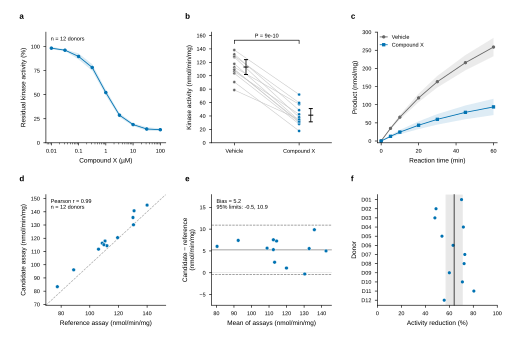
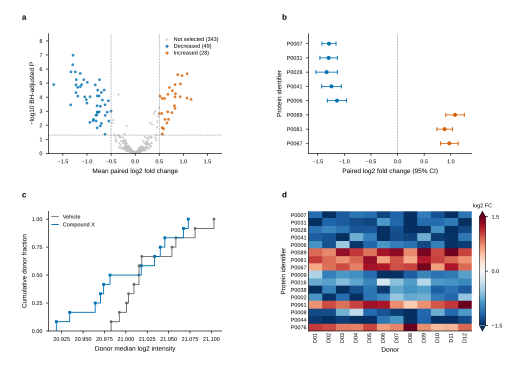

# Nature Methods Figure Toolkit

A reproducible scientific figure toolkit for generating publication-quality statistical plots and multi-panel figures using **Matplotlib, Seaborn, and Scanpy/AnnData**.

Designed around the official Nature Methods and Nature Research figure preparation guidelines.

### Figure Outputs and Editing

The toolkit automatically exports each figure in three formats:

- **PDF**: Publication-ready vector graphics for journal submission.
- **SVG**: Editable vector graphics for manual refinement.
- **PNG**: High-resolution (300 dpi) images for preview and sharing.

### Example Output

The following figure demonstrates the toolkit's publication-style output using simulated data.





**Recommended Subsequent workflow:** Use Codex/Python for data-driven changes and Adobe Illustrator/Inkscape for final visual refinement. Preserve the source code and editable SVG alongside the final PDF to ensure reproducibility and flexibility.

Figures can be further modified through two workflows:

**Option A: Adobe Illustrator / Inkscape (SVG Editing)**  
Open the exported SVG file to manually refine typography, colors, labels, legends, and panel layouts. Vector elements remain editable, allowing precise adjustments without loss of image quality.

- Tips: Editing SVG in Adobe Illustrator. Matplotlib exports SVG files with multiple nested `<g>` groups for axes, ticks, text, and data points. In Adobe Illustrator, these nested groups may require repeatedly double-clicking to enter isolation mode when editing text. You can select all objects with `Cmd + A`, then use **Object → Ungroup** (`Shift + Cmd + G`). You can then use the **Type Tool (T)** to edit text directly.

**Option B: Codex / Python (Source Code Editing)**  
Modify the original plotting code to update data, statistical analyses, axis settings, plot types, or other visualization parameters. Re-run the script to regenerate all three output formats reproducibly.

### Features

- **Publication-ready styling:** Consistent typography, dimensions, accessible colors, and panel layouts.
- **Editable vector outputs:** PDF and SVG with embedded fonts and editable labels, alongside PNG previews.
- **Reproducible figures:** Source code, plotted data, statistical metadata, and provenance records.
- **Multi-panel assembly:** Consistent layouts and panel labeling for complete manuscript figures.
- **Automated quality control:** Checks for physical dimensions, font embedding, SVG text editability, and file integrity.
- **Codex integration:** Repository-level instructions through `AGENTS.md`.

### Quick Start

Install the Python dependencies:

```bash
pip install -r requirements-optional.txt
```

On macOS, install the recommended font:

```bash
brew install --cask font-arial
```

Run figure quality control:

```bash
python figure_qc.py figures/exports --strict
```

### Scope

This toolkit provides a reusable workflow for scientific visualization and figure preparation. Authors remain responsible for statistical validity, data integrity, interpretation, and compliance with the target journal's latest submission requirements.

### References

- [Nature Research Figure Guide](https://research-figure-guide.nature.com/)
- [Nature Methods](https://www.nature.com/nmeth/)

### License

MIT License for the toolkit code. Third-party fonts and other dependencies retain their respective licenses.
